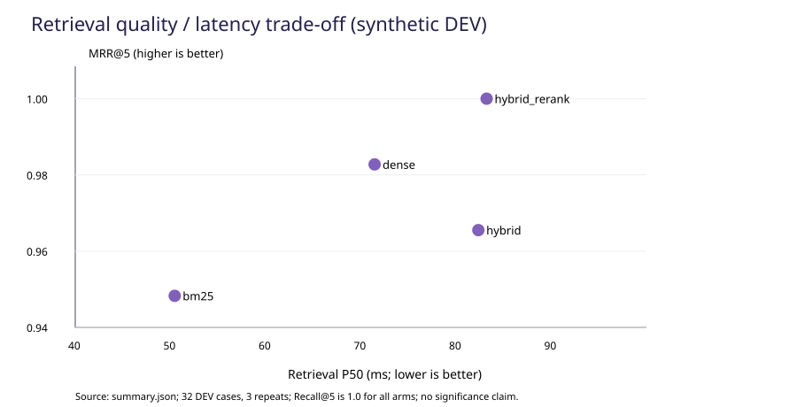
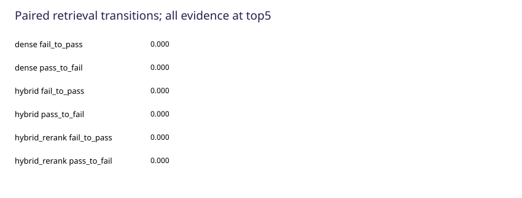

# ComAgent RAG 评测与优化报告

版本：`rag-fixtures-v1` · 结果日期：2026-10-31 · 性质：原创合成开发语料上的探索性对照

本报告说明如何把 RAG 从“能够检索和回答”推进到“能够解释错误、比较方案并验证回归”。实际完成的工作包括分层评测入口、可追溯证据标签、四种检索策略对照、固定证据诊断、逐题结果记录和无收费 API 的持续回归。

**当前可证实的收益是排序改善。** 在本次 29 道可回答开发题上，BM25 与混合检索加轻量重排的 Recall@5 均为 1.0000；后者的 MRR@5 从 0.9483 提高到 1.0000，nDCG@5 从 0.9591 提高到 1.0000，检索 P50 则从 50.44 ms 增加到 83.21 ms。该结果不能改写为“答案准确率达到 100%”或“召回率提高”。

**当前仍未核验的部分是生成式答案质量。** 本轮没有调用 DeepSeek 或其他收费生成模型，全部回答实验采用摘录模式；答案语义正确性、忠实性和引用支持均保留 `not_verified`。所有参考标签仍待人工审核，原文哈希和引句核验不代替人工签字。

## 1. 评测目标与系统边界

RAG 的端到端错误可以发生在多个位置：原文没有解析出来、必要信息被切散、检索候选遗漏、相关片段排名靠后，或者回答层拿到证据后仍遗漏条件、错用单位、附上不支持结论的引用。只观察最终回答，难以判断下一步应改检索、改切片还是改生成。

本项目把上述链路拆成三种可独立执行的流程，复用生产模块，不在评测中另写一套简化检索器。

| 评测层 | 运行入口 | 输入与真实执行内容 | 可回答的工程问题 |
|---|---|---|---|
| 检索层 | [run_retrieval.py](run_retrieval.py) | 问题、允许文档范围、同一冻结索引；调用实际检索模块 | 必要证据是否被召回、排在什么位置 |
| 固定证据层 | [run_generation.py](run_generation.py) | 显式提供参考证据、带干扰证据或缺失关键证据；调用实际回答模块 | 证据输入与回答层是否正确衔接，哪些诊断条件还需要语义核验 |
| 完整 RAG 工具链 | [run_end_to_end.py](run_end_to_end.py) | 实际检索后，把实际片段传给实际回答模块 | 检索结果、回答、引用与 trace 能否完整关联 |

正常检索与完整工具链在预测阶段不读取参考答案来选择文档。固定证据实验会读取标签，属于独立诊断条件，不计入正常系统成绩。评测入口不会访问 PostgreSQL，也不会载入旧 Agent 的 200 道综合题或旧保留集。

这里的“完整 RAG 工具链”不等于整个 Agent 的所有功能。问题分类、SQL 路由、真实用户多轮状态更新、工作台网络往返和并发服务能力没有包含在本批计时范围内。评测器保存边界，而不是把一个组件的成绩扩展到整个产品。

## 2. 开发集设计与证据标签

公开样本包含 10 份原创虚构资料，分别描述 Cedar 云工作区服务、Atlas 泵站与同名软件实验室、Harbor 资料服务及指标口径。语料包含 7 份 Markdown、3 份 HTML，真实解析后形成 40 个片段。全文及标签的许可仅覆盖这批新增材料，不涉及原用户知识库或第三方业务文件。

| 题型 | 数量 | 主要检查内容 |
|---|---:|---|
| 单片段事实 | 6 | 响应时限、价格、版本、日志保留期等明确事实 |
| 显式全库检索控制 | 2 | 与单文档同题配对，观察扩大检索范围后的排序 |
| 数字、期间与单位 | 6 | 2025/2026、比例、分钟、币种与计量口径 |
| 同名实体与相似资料 | 6 | 中国大陆/美国、东区/西区、泵站/软件实验室 |
| 多片段必要证据 | 3 | 一个答案需要窗口与时长、时限与起算点等多项信息 |
| 跨文档 | 3 | 两地价格、两区台数、服务目标与口径定义 |
| 无答案 | 3 | 未披露的未来承诺、私人电话、补丁日期 |
| 续问检索 | 3 | 保留历史，使用显式有效问题检索地区、年份或对象变更 |
| 合计 | **32** | **29 道可回答、3 道无答案** |

每道题记录原编号、问题家族、允许范围、可回答性、参考答案要点、必要证据、审核状态和续问上下文。35 条必要证据均绑定**文档 ID、原始文件 SHA256、真实章节、页码及原文引句**，没有把 `chunk_id` 当作永久标签。

Markdown/HTML 没有 PDF 物理页，故 `page` 明确为 `null`；章节使用正式解析器实际生成的路径。更换切片参数后，可以重新将原文标签映射到新片段，而无需凭旧片段编号改答案。程序核验哈希、允许范围、真实位置与规范化完整引句；数字碰巧出现、页面相同或者标题相近，均不足以命中标签。

所有样本仅为 `dev`。其中两组同题的单文档／全库控制属于同一问题家族，不能当作彼此独立的未见样本。三道续问使用作者明确填写的 `retrieval_question`，因此可以验证“保留后的问题能否检索到正确资料”，不能证明 Agent 自动合并条件已经成功。

材料入口：[dataset.json](fixtures/dataset.json)、[manifest.csv](fixtures/manifest.csv)、[provenance.json](fixtures/provenance.json)、[原创原文目录](../../data/benchmark_fixtures/rag/)。标签状态保持 `pending_human_review`。

## 3. 评测架构与可追溯记录

评测器按以下顺序工作：读取所选开发集，验证标签结构与来源，创建独立索引，按策略和重复编号执行，逐题落盘，计算机械指标，最后生成配对对照和报告。输出目录已经存在时拒绝覆盖，避免再次运行无意替换前一批结果。

```text
版本化问题与来源标签
        ↓ 结构、范围、原文哈希与引句校验
独立冻结索引（不替换用户知识库）
        ↓
只测检索 / 固定证据回答 / 检索后回答
        ↓
逐题实际排名、输入片段、回答、引用、trace、usage
        ↓
机械指标与错误分类 → 同题配对 → 独立语义审核
```

| 文件 | 职责 | 保证 |
|---|---|---|
| [dataset.py](dataset.py) | 严格数据模型、来源核验、分组与拆分检查 | 同家族或会话不跨 dev/test；最终测试必须显式启用 |
| [runner.py](runner.py) | 冻结配置、准备索引、驱动实验和保存记录 | 正常预测只使用问题及允许范围；每次实际输出单独保存 |
| [evaluation.py](../../qa_agent/rag/evaluation.py) | 对实际检索与回答模块提供薄适配 | 固定证据与正常证据使用同一个回答实现 |
| [metrics.py](metrics.py) | 来源证据覆盖、排序、引用结构与词面诊断 | 机械匹配不自动生成语义正确率 |
| [compare.py](compare.py) | 校验条件并做同题配对 | 保留正收益、负收益、零收益与失败 |
| [review.py](review.py) | 导入与预测哈希绑定的语义审核 | 新回答不能套用旧回答的审核；AI 与人工分开统计 |
| [report.py](report.py) | 汇总分母、时延、用量、失败和图表 | 缺失 usage 与未审核项明确显示未知 |

`predictions.jsonl` 是逐题主记录；`results.csv` 便于筛选；`summary.json` 保存计算值；`manifest.json` 保存运行条件；`review-template.json` 供后续语义审核。代表案例只是阅读入口，完整失败不因未入选案例而删除。

## 4. 指标定义与判分协议

设问题 (q) 有必要证据集合 (E_q)，前 K 个实际检索片段为 (R_q^K)。只有来源、页码／章节以及规范化完整引句满足标签时，才认定某条必要证据被该片段覆盖。

**证据 Recall@K** 定义为已覆盖的唯一必要证据数除以全部必要证据数。同一证据被多个重叠片段命中只计一次；一块确实包含两条必要证据时，可以覆盖两条。**Hit@K** 检查是否至少覆盖一条；**MRR@K** 是第一条命中片段排名的倒数，前 K 无命中则为零。最终取可回答问题的宏平均。

**标准 nDCG@K** 使用冻结允许语料的片段级二元相关性标注：某个片段若覆盖任一必要证据，则相关性为 1，否则为 0。按实际名次计算：

```text
DCG@K  = Σ rel_i / log2(i + 1), i = 1..K
IDCG@K = 将允许语料中的相关片段按理想顺序排列后得到的 DCG@K
nDCG@K = DCG@K / IDCG@K
```

理想分母来自**全部允许语料中的相关片段**，不是模型返回的那几个片段，也不是必要证据条数。不同重叠片段可以各自具有二元 qrel；同一个 `chunk_id` 在排名中重复不会增加得分。另保留 `novelty_ndcg@5` 作为新证据贡献诊断，不能把它当作标准 nDCG 混报。

无答案题没有正证据，不进入 Recall/MRR/nDCG 的正证据分母；可回答题发生执行失败仍保留在分母中并计零。当前主检索实验每组有 29×3＝87 个可回答题次，但独立题目仍只有 29 道，不能把重复数用于扩大样本代表性。

答案层同时记录四类信息：词面要点覆盖、引用 ID 合法性、真实拒答状态、独立语义审核。数字检查避免把 20 误匹配到 2026；这仍然只能证明文字出现，不能证明对象、期间或结论成立。`SUCCEEDED` 只表示工具成功返回，不能直接用作答案正确标签。

语义审核分别判断答案正确、事实支持和引用支持，不合成含义不清的单一总分。没有绑定当前预测哈希的审核，相关指标保持空值。引用 ID 存在只能说明引用结构有效；一句话是否得到对应证据支持，需要单独核对。

## 5. 实验条件与版本冻结

四组使用相同题目、允许范围、原始正文、切片、Top-K、索引来源和指标协议，仅改变声明的检索策略。全库题向四组提供同一批全部允许文档，不根据 Gold 选择正确来源。

| 条件 | 本次设置 |
|---|---|
| Python / 系统 | Python 3.12.10；Windows 11，具体平台字符串见 manifest |
| 本地检索模型 | BAAI/bge-m3 的 Xenova ONNX 转换；CPU、QInt8、1024 维、CLS 池化、L2 归一化 |
| 模型修订 | `4de13258303883538bd53b696b452bf8099f0858`；权重 SHA256 及分词器哈希随 manifest 保存 |
| 编码长度 / 批量 | 最大 512 token；batch size＝2 |
| 切片 | 最大 500 字符，重叠 80；按完整句／表格行边界，不跨页或章节；本次 40 片段 |
| 检索 | Top-K＝5；每通道候选预算＝20；RRF k＝60 |
| 重排 | RRF、词项覆盖、短语覆盖的轻量组合，并保留来源邻居补全；非 Cross-Encoder |
| 缓存 | `cold`：逐请求清空应用检索缓存；不清空 OS 页缓存和编码器会话 |
| 生成模式 | `extractive`；不调用 DeepSeek、不启用模型裁判 |

每通道候选预算相同，不代表所有组总候选量或总计算量相同：Hybrid 可以融合两路候选，理论上最多有 40 个不同候选。BM25 采用显式开关，不访问向量查询编码器；它与向量实验仍共享同一冻结语料，没有通过删权重伪造消融。

本轮四策略对照配置为 [retrieval-v1.json](configs/retrieval-v1.json)。运行时 Git 基座为 `72933fd941c499ac8ab7c51ddcd75a98d1a54a2a`，该提交本身不包含本轮所有新评测代码。实际执行版本以 manifest 的 `source_files` 和 `code_sha256` 为准，不能把旧基座说成包含本轮实现的最终提交。

| 冻结对象 | SHA256 |
|---|---|
| 本轮代码清单摘要 | `981f4214964bc1970be340480b03941cf8f2c2b915bdb2fb249a1d355ee255f3` |
| 数据集 | `5de0ed8d81c7f5740d62b4b744bd2b6c1282832e054297217fa6f6410bff9671` |
| 来源 manifest | `0ad3c8dbd357696866ef4b8a04d577e89dfe4e33fc8f26a8641c869055ce86d8` |
| 冻结片段文件 | `d8ad2c01116972f2a5f806bbc669d5e7746ab173aacb19162d1731c587a95833` |

代码哈希协议先将 CRLF 规范为 LF；原始文档哈希使用实际字节。完整来源哈希、依赖版本、命令和模型信息见 [运行清单](results/retrieval-v1/manifest.json)。这种记录方式可区分“源码基座没有变”和“实际运行文件发生变化”。

## 6. 实际批次与检索策略对照

本轮共保存 608 个逻辑题次，未将重复次数或固定证据条件当作新增独立问题。

| 批次 | 实际规模 | 用途 |
|---|---:|---|
| [retrieval-v1](results/retrieval-v1/report.md) | 4 策略×32 题×3 重复＝384 | 检索质量及重复耗时 |
| [end-to-end-v1](results/end-to-end-v1/report.md) | 4 策略×32 题×1 次＝128 | 检索到摘录回答的实际工具衔接 |
| [reference-v1](results/reference-v1/report.md) | 32 | 全部参考证据输入 |
| [reference-noise-v1](results/reference-noise-v1/report.md) | 32 | 参考证据加干扰 |
| [missing-key-v1](results/missing-key-v1/report.md) | 32 | 删除最后一条必要证据 |

主检索实验的真实结果如下。MRR 与 nDCG 是排序分值，不是答案正确率；Precision 的分母为固定 K。

| 策略 | 独立可回答题 | 可回答题次 | Hit@5 | Recall@5 | MRR@5 | nDCG@5 | 执行失败 |
|---|---:|---:|---:|---:|---:|---:|---:|
| BM25 | 29 | 87 | 1.0000 | 1.0000 | 0.9483 | 0.9591 | 0 |
| Dense | 29 | 87 | 1.0000 | 1.0000 | 0.9828 | 0.9873 | 0 |
| Hybrid（BM25＋Dense＋RRF） | 29 | 87 | 1.0000 | 1.0000 | 0.9655 | 0.9745 | 0 |
| Hybrid＋轻量重排与来源补全 | 29 | 87 | 1.0000 | 1.0000 | 1.0000 | 1.0000 | 0 |

BM25 到最终组的 MRR 绝对增量为 **+0.0517**，nDCG 绝对增量为 **+0.0409**，Recall 增量为 **0**。在这批小语料上，真正观察到的是“正确证据更靠前”，而不是“原来找不到、现在找得到”。按前五片段完整覆盖所有必要证据判定配对通过，所有组均为 87/87，因此错转对、对转错均为 0。

Hybrid 的 MRR 和 nDCG 比 Dense 分别低约 0.0172 和 0.0127。这是应保留的负收益：RRF 只融合排名，不能保证每道题优于最佳单通道。增加一条信号较弱的词项排序后，某些旧版本片段仍排在新版证据之前。该观察支持逐题检查融合排名，而不是认定“混合一定更好”。

四组 Precision@5 均约为 0.2276。这和 Recall@5＝1 可以同时成立：多数问题只需要一个片段，返回五个片段会带入其他内容。nDCG＝1 也不意味着五个片段都相关，而是相关片段在当前 qrel 的理想位置。小数据集上的指标饱和，是下一阶段增加难例和语料规模的理由，不能解释为产品已经没有检索错误。



图 1 与[逐题预测](results/retrieval-v1/predictions.jsonl)、[汇总 JSON](results/retrieval-v1/summary.json)对应；排序改善和时延代价应结合本节表格与下一节阅读。必要证据覆盖的零增益另见[覆盖对照图](results/retrieval-v1/quality.svg)。

## 7. 时延、计算成本与工程取舍

P50 表示一半计时记录不高于该值，P90 表示九成记录不高于该值。本次采用排序样本位置 `(n−1)×p` 的线性插值方法，每组计入 32×3＝96 次检索，包括无答案题。索引构建单独记录，不能与每次查询耗时混合。

| 策略 | 检索 P50 / ms | 检索 P90 / ms | 检索入口总耗时 P50 / ms | 检索入口总耗时 P90 / ms |
|---|---:|---:|---:|---:|
| BM25 | 50.44 | 61.03 | 50.56 | 61.17 |
| Dense | 71.44 | 82.06 | 71.55 | 82.17 |
| Hybrid | 82.34 | 100.47 | 82.54 | 100.70 |
| Hybrid＋轻量重排与来源补全 | 83.21 | 104.12 | 83.44 | 104.30 |

与 BM25 相比，最终组检索 P50 增加约 **32.77 ms，约 65.0%**。与 Hybrid 相比，最终组的检索 P50 增加约 **0.87 ms**。后一个比较只反映本次运行的增量，不能推导为所有规模上重排的固定开销；具体阶段记录保存在逐题 `retrieval_timing_ms` 中。

完整摘录工具链的 P50 分别为 50.36、72.48、81.65、81.36 ms，来自另一个单轮批次。最终组在该批次略快于 Hybrid，可能受运行时波动影响，不能和三重复主检索实验拼接，宣称重排使系统加速。不同批次分开报告，可以避免挑选较快的一次作为结论。

本次 cold 只指应用检索缓存清空。OS 页缓存、已加载的 ONNX 会话和进程环境保留；既不是整机冷启动，也不是模型每次重新加载。没有运行 warm 对照、20 并发吞吐或大规模索引实验，因此本表不能证明生产服务的容量上限。

全部已交付批次的外部生成模型物理调用次数、输入 token、输出 token 均为 0。向量编码在本机 CPU 实际执行，不应因为“API 调用为零”就写成“没有计算成本”。运行器支持记录 provider 缓存命中与未命中输入；本轮没有此类调用。金额字段保持未核验，没有套用未经确认的 API 单价。

工程选择应同时考虑排序质量、允许时延和资料规模。对于只需 Top-5 完整证据、且成本敏感的这批固定样本，BM25 已满足覆盖要求；对于希望正确版本首先出现的场景，当前轻量重排提供了可量化的排序收益。更复杂模型应以新增实验组进入，不能直接把当前重排改名为神经重排。

## 8. 固定证据诊断与摘录模式的实际限制

固定证据实验将检索与回答拆开。`reference` 使用标签列出的全部证据；`reference_noise` 在此基础上增加允许范围内的干扰片段；`missing_key` 删除最后一条必要证据。这些条件都绕过真实检索，因此只能用于定位回答层，不进入主检索成绩。

| 条件 | 实际输入变化 | 实测拒答结果 | 可以说明什么 |
|---|---|---|---|
| reference | 可回答题得到全部标签证据；原无答案题得到空证据 | 原 3 道无答案题均返回 `EMPTY_RESULT` | 空证据路径和摘录模块连通 |
| reference_noise | 参考证据加干扰；原无答案题也可能得到干扰片段 | 原 3 道无答案题均未返回拒答状态 | “有片段”不能作为“有答案”的充分条件 |
| missing_key | 每题移除最后一项必要证据 | 新条件下 32 题均不再具有完整必要证据；26/32 返回拒答状态 | 空输入可以拒答；仍有残余片段时会继续摘录，不能保证回答完整 |

`missing_key` 的拒答召回率 0.8125 的分母是**该诊断条件下的 32 道题**，不是原始 3 道无答案题。29 道原可回答题删除必要证据后，已改变该条件的可回答性，不能把这份结果当作正常系统拒答成绩。

正常检索后的摘录工具链中，每个策略的三道无答案题都未进入拒答状态，无答案拒答召回为 0/3；可回答题误拒率为 0/29。四组共 12 条“无答案未拒答”记录均保留在[完整工具链输出](results/end-to-end-v1/predictions.jsonl)。这些不是收费模型产生的幻觉，因为本轮没有调用生成模型；它揭示的是摘录模式缺少“非空证据是否足以回答”的语义判定。

同样，reference 条件的 3/3 拒答来自“标签为空→输入为空”的机械路径，不证明模型具备抗幻觉能力。在没有真实 LLM 生成和独立语义审核前，不能把固定参考证据实验解释为“给对证据后答案全部正确”。

## 9. 逐题错误归因与代表案例

错误分类按证据链分层记录，允许一个样本同时具有多个问题。`first_evidence_below_rank_1` 表示第一条必要证据低于第一名，是排序诊断，不是完整回答错误标签；`unanswerable_not_refused` 表示实际状态未拒答，不自动推断发生事实编造。语义错误需要另外审核。


下表保留改善案例和未解决限制。所有描述均以当前未完成人工审核的标签为参照，完整原始输出不因报告中的概括而被替换。

| 编号与问题 | 实际观察 | 分层诊断与处理结论 | 证据位置 |
|---|---|---|---|
| rag-dev-002：2026年优先支持响应时限，全库范围 | BM25 第一名为 2025 历史版，2026 证据第二名；最终组正确证据第一名 | 当前标签下的版本排序错误；覆盖率没有变化。逐题排名可证明改善发生在哪里 | retrieval-v1，repeat＝1，BM25 第2行、最终组第98行 |
| rag-dev-003：2026年可用性目标 | BM25、Hybrid 把 2025 的 99.5% 排在 2026 的 99.9% 前；最终组命中第一名 | 年份与对象应同时参与排序，不能因为同类数字出现就判命中；排序改善已见记录 | retrieval-v1，repeat＝1，BM25 第3行、Hybrid 第67行、最终组第99行 |
| rag-dev-007：2026年服务抵扣上限 | BM25 首先返回旧版10%，正确20%在第二名；Hybrid和最终组正确证据在第一名 | 词项相似不能替代版本有效性。这里的改进可定位到融合/排序层，不需要重造答案 | retrieval-v1，repeat＝1，BM25 第7行、Hybrid 第71行、最终组第103行 |
| rag-dev-011：中国大陆存储配额 | Dense 将美国100GB排第一，中国大陆200GB排第二；BM25、Hybrid和最终组正确证据在第一名 | 向量语义相近仍可能混地区。该例说明 Dense 单通道也有边界 | retrieval-v1，repeat＝1，Dense 第43行、最终组第107行 |
| rag-dev-006：2027年服务承诺，资料未给出 | 正常检索后摘录2025/2026材料，状态为 `SUCCEEDED`；reference空证据时才拒答 | 未解决的证据充分性限制。需要真实语义判断后再评价，不能拿旧年份替未来承诺 | end-to-end-v1 与 reference-v1，同编号 |
| rag-dev-025：私人电话号码 | 资料没有披露电话；正常摘录仍返回相关负责人资料且未拒答 | 非空相关片段不等于答案存在；目前只作失败诊断，不杜撰电话或改标签 | end-to-end-v1，同编号；原文 atlas-east |
| rag-dev-026：下一次系统补丁日期 | 资料明确未给出日期；正常摘录不拒答，噪声条件也不拒答 | 拒答协议未在摘录模式实现充分性判断。保持未解决状态，不用虚构“抗噪声通过”掩盖 | end-to-end-v1 与 reference-noise-v1，同编号 |
| rag-dev-024：静态及传输加密 | 正常检索两条证据齐全，词面覆盖1.0；移除TLS证据后只余AES，覆盖0.5，仍返回 `SUCCEEDED` | 成功状态、事实出现和完成全部要求是不同维度。缺关键证据诊断确实暴露了遗漏 | end-to-end-v1 与 missing-key-v1，同编号 |
| rag-dev-032：服务目标及指标分母 | 正常检索两源证据均覆盖；删除口径证据后词面覆盖降至0.5，仍摘录目标值 | 检索完整性与答案完整性必须分开；不能只因99.9%出现就认为问题全部答完 | end-to-end-v1 与 missing-key-v1，同编号 |

检索案例的行号均指 [retrieval-v1/predictions.jsonl](results/retrieval-v1/predictions.jsonl) 中第一重复的原始记录，策略和题目编号可再次筛选。固定证据与端到端案例可在各目录的 `predictions.jsonl` 使用相同 ID 查找，不把两个条件的预测混为一次输出。



图 3 使用“全部必要证据是否进入前五”作为配对标准，因此保持 87 次通过→通过、0 次错→对。这与 MRR、nDCG 的排序收益不矛盾。不同通过标准应标在图旁，不应只放一个没有定义的“提升率”。

## 10. 语义审核、来源核查与 CI

当前证据核验已完成原始文件 SHA256、真实章节、页码空值语义和35条引句存在性的程序检查；所有标签依旧待人工审核。审核应检查题意、对象、期间、单位、参考要点和证据是否充分，然后再判断系统回答。

答案审核模板将答案正确性、事实支持率、引用支持准确率和答案要点完整性分开填写。审核内容必须引用当前 `prediction_sha256`；程序拒绝将某次旧回答的审核套到新预测上。`ai` 与 `human` 审核分别记录，AI 预审不能生成 A/B 签名或改变标签批准状态。

[semantic-review-unfilled.json](results/end-to-end-v1/semantic-review-unfilled.json) 保留本轮未填写语义审核的状态。当前不发布“答案正确率”“人工忠实度”“引用语义支持率”的数值。引用 ID 合法与语义支持充分是两个检查对象，前者通过不能填补后者的空值。

持续集成定义位于 [rag-eval.yml](../../.github/workflows/rag-eval.yml)。它运行不需要密钥的小规模指标、运行适配、CLI和报告回归，并检查无 API 路径。完整模型评测仍须手动选择、给出调用预算和截止时间；代码提交不会自动触发收费造数或裁判。

相关检查重点包括：重复片段不能增加新证据、标准 nDCG 的理想分母来自全语料、缺失向量资源不能冒充已完成 Dense 组、正常预测不能得到 Gold 文档提示、跨分组条件不一致应拒绝比较、缺失 usage 不能当作零费用、生成式请求必须有显式预算。

## 11. 复现路径与交付文件

在项目根目录使用 Python 3.12 和运行依赖。已有虚拟环境时复用，不需要为评测启动 Docker、数据库或工作台。详细环境说明见 [评测使用说明](README.md) 和[项目 README](../../README.md)。以下输出目录使用新的名称；已经存在时应更换名称，不覆盖历史结果。

```powershell
$py = ".\.venv\Scripts\python.exe"
& $py -m pip install -r requirements-runtime.txt

# 最小无向量、无模型API检查
& $py -m benchmarks.rag.run_retrieval --strategies bm25 --embedding none --repeat 1 --output .runtime/rag-eval/bm25-new

# 本地BGE已准备时复现四策略、三次重复
& $py -m benchmarks.rag.run_retrieval --config benchmarks/rag/configs/retrieval-v1.json --deadline-seconds 1200 --output .runtime/rag-eval/retrieval-new

# 同四策略的单轮摘录工具链
& $py -m benchmarks.rag.run_end_to_end --embedding bge --strategies bm25 dense hybrid hybrid_rerank --repeat 1 --answer-mode extractive --output .runtime/rag-eval/end-to-end-new

# 三类固定证据诊断，分别落盘
& $py -m benchmarks.rag.run_generation --condition reference --answer-mode extractive --output .runtime/rag-eval/reference-new
& $py -m benchmarks.rag.run_generation --condition reference_noise --answer-mode extractive --output .runtime/rag-eval/reference-noise-new
& $py -m benchmarks.rag.run_generation --condition missing_key --answer-mode extractive --output .runtime/rag-eval/missing-key-new
```

需要 BGE 而本地没有权重时，先按使用说明执行 `scripts/download_embeddings.py`，下载固定修订并核验哈希；网络不可达应报告阻塞，不使用假向量代替。模型权重不随公开源码上传。

本轮交付的实际命令保存在每个批次的 manifest。上述命令是复现入口，不表示本报告再次执行了另一套批次。换机器后质量在相同模型与数据下仍应核对，但时延会受硬件和运行环境影响，不要求复制出完全相同的毫秒值。

如果后续要运行真实生成式模型，必须显式选择 `--answer-mode llm` 并指定 `--max-model-calls`。默认预算为零；失败、校验重生成和缺失 usage 都计入预算协议。测试完成后再进行独立语义审核，不能用现有摘录结果预填生成质量。

| 查阅目的 | 交付位置 |
|---|---|
| 主结果与排序收益 | [检索 summary.json](results/retrieval-v1/summary.json) |
| 实际检索、各通道排名与时延 | [检索 predictions.jsonl](results/retrieval-v1/predictions.jsonl) |
| 实际证据、摘录答案、引用和trace | [完整工具链 predictions.jsonl](results/end-to-end-v1/predictions.jsonl) |
| 分阶段诊断 | [reference](results/reference-v1/)、[reference_noise](results/reference-noise-v1/)、[missing_key](results/missing-key-v1/) |
| 环境、源码、来源、模型、命令 | 各批次 `manifest.json` |
| 同题增减 | [paired-comparison.json](results/retrieval-v1/paired-comparison.json) |
| 审核模板 | 各生成批次 `review-template.json` |

## 12. 结论、限制与方法参考

本轮形成了能够公开复现的评测工程：标签绑定原文而非易变片段，预测与 Gold 分开消费，四种策略使用受控范围对照，检索、固定证据、完整工具链分别计分，原始输出与代码版本一起保存。通过该流程，能够指出“错在旧版本排第一”“错在地区相似”“缺少第二条证据却继续返回成功”，而不是把所有失败归咎于模型能力。

已观察到的正向结果是轻量重排改善 MRR/nDCG；零收益是 Recall@5 保持不变；负向结果是 Hybrid 排序弱于 Dense，以及最终组相对 BM25 增加时延。未解决的限制包括摘录模式的证据充分性判定和无答案拒答。报告保留这些结果，使后续是否采用某项技术可以依据真实取舍。

这批10文档、32开发题规模较小，且为原创合成资料。全部参考标签待人工审核，没有独立最终测试集，没有真实用户问题分布、长 PDF/OCR、表格图像或跨语种压力验证。三次重复没有扩大独立样本数，当前不作统计显著性或生产泛化宣称。没有运行收费生成模型、神经 Cross-Encoder、模型裁判、大规模并发或费用单价核验，也没有把原200道 Agent 题重新命名为 RAG 题。

后续顺序应为：先人工确认这批证据与答案要点，补充真实授权资料和困难无答案样本；按文档、家族或会话划分独立开发／测试；在明确预算下执行真实检索证据和参考证据的生成式对照；最后通过预测哈希绑定的语义审核校准答案、忠实性和引用指标。最终测试不用于反复选择更好的配置。

方法参考仅表示设计借鉴，不表示本项目完整接入这些框架或复现其论文成绩：

- **排序指标和 qrels**：BEIR 官方评测实现分别计算 nDCG、Recall、Precision 等排序指标，本项目采用可审计的二元片段 qrels，并额外保存必要原文证据覆盖。[BEIR evaluation.py](https://github.com/beir-cellar/beir/blob/main/beir/retrieval/evaluation.py)
- **检索与生成拆解**：RAGChecker 以细粒度诊断区分检索与生成问题；本项目借鉴这种拆分思路，但本轮未调用其模型式断言核验，不把机械引句命中称为语义蕴含。[RAGChecker 官方源码](https://github.com/amazon-science/RAGChecker)
- **质量维度独立评价**：Ragas 将上下文召回、噪声敏感性、回答相关性、忠实性等指标分开组织；本项目相应保留独立维度，未审核的语义字段保持空值。[Ragas 官方指标说明](https://docs.ragas.io/en/stable/concepts/metrics/available_metrics/)

用于项目经历的准确表述可以是：**实现分层 RAG 评测与回归链路，构建带原文位置和来源哈希的32题合成开发集，在同源对照中定位版本混淆、地区混淆和证据缺失；实跑四种检索策略，验证轻量重排的排序收益、时延代价与当前拒答限制。**
