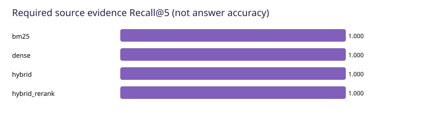
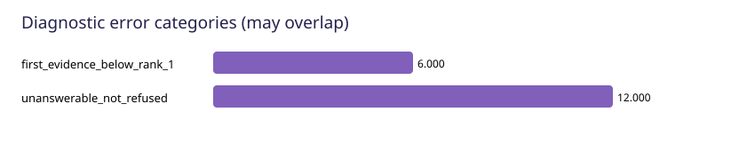

# RAG评测与优化报告

## 1. 结论边界

本报告由真实工具调用记录生成。使用原创合成开发语料验证评测链路；标签仍待人工审核。它不是公开基准成绩，也不能证明真实用户场景泛化能力。
检索使用原文位置与规范化文本证据标签；关键词/数字/引用ID检查属于机械诊断。答案正确性、忠实性和引用语义支持分别保留为 not_verified。
本次模式：`end_to_end`；生成方式：`extractive`；缓存：`cold`。

## 2. 数据与隔离

数据集版本 `rag-fixtures-v1`，SHA256 `5de0ed8d81c7f5740d62b4b744bd2b6c1282832e054297217fa6f6410bff9671`。只运行 dev，未读取或预测旧保留集。原200题继续属于Agent综合评测。
来源标签固定到文档哈希、页码/章节和原文引句，不绑定某次切片的chunk_id。同家族、同会话不得跨开发/测试集泄漏。当前未建立独立最终测试集。
多轮题提供显式有效检索问题；这里只测试有效问题下的检索，不把它当成多轮重写成功率。

## 3. 实验控制

共用 40 个片段、同一来源哈希、相同切片、Top-5 和每通道候选预算 20。
混合检索可以融合两路候选，因此总候选量不一定与单通道相同；这里控制每通道预算，不宣称相同总计算量。当前重排为词项/短语覆盖率与RRF分数的轻量重排，不是Cross-Encoder。
cold逐请求清空应用检索缓存；warm先执行同一查询预热再计时。操作系统页缓存和ONNX会话不清空，故不是机器冷启动。索引构建耗时单独记录。

## 4. 检索指标与真实结果

Recall@5：前5片段覆盖的唯一必要原文证据比例。MRR@5：第一条命中证据的倒数排名。nDCG@5：在允许范围的完整冻结语料上建立chunk-ID二元相关性标签，依据全体相关片段计算理想DCG；命中任一正确来源引句则相关。
一块覆盖多个证据时Recall可同时计入，标准nDCG按该块的binary qrel计分。不同重叠片段是不同qrel，同一chunkID重复不加分；额外novelty_ndcg只作去重新证据诊断，不与标准nDCG混用。无答案题不进入正证据Recall分母；执行失败在可回答题分母中计0。

|策略|可回答题次|Hit@5|Recall@5|MRR@5|nDCG@5|失败|
|---|---:|---:|---:|---:|---:|---:|
|bm25|29|100.00%|100.00%|0.9483|0.9591|0|
|dense|29|100.00%|100.00%|0.9828|0.9873|0|
|hybrid|29|100.00%|100.00%|0.9655|0.9745|0|
|hybrid_rerank|29|100.00%|100.00%|1.0000|1.0000|0|

## 5. 质量与时延

|策略|检索P50/P90(ms)|端到端P50/P90(ms)|物理调用|输入/输出token|
|---|---:|---:|---:|---:|
|bm25|49.658500000000004 / 54.0235|50.3575 / 54.6999|0|0 / 0|
|dense|71.2525 / 85.9311|72.483 / 86.92909999999999|0|0 / 0|
|hybrid|80.8495 / 95.74719999999999|81.652 / 96.7719|0|0 / 0|
|hybrid_rerank|80.33449999999999 / 96.3398|81.3565 / 97.16259999999998|0|0 / 0|

每次真实请求和重试都保留。缺失usage不按零token处理。未提供可靠单价，金额保持未核验。检索-only和extractive运行没有付费模型调用，不能据此报告DeepSeek生成质量。

## 6. 配对增减

{
  "dense": {
    "baseline": "bm25",
    "criterion": "all required source evidence at top5; not answer correctness",
    "pairs": 29,
    "recall_at_5_delta": 0.0,
    "fail_to_pass": 0,
    "pass_to_fail": 0,
    "pass_to_pass": 29,
    "fail_to_fail": 0
  },
  "hybrid": {
    "baseline": "bm25",
    "criterion": "all required source evidence at top5; not answer correctness",
    "pairs": 29,
    "recall_at_5_delta": 0.0,
    "fail_to_pass": 0,
    "pass_to_fail": 0,
    "pass_to_pass": 29,
    "fail_to_fail": 0
  },
  "hybrid_rerank": {
    "baseline": "bm25",
    "criterion": "all required source evidence at top5; not answer correctness",
    "pairs": 29,
    "recall_at_5_delta": 0.0,
    "fail_to_pass": 0,
    "pass_to_fail": 0,
    "pass_to_pass": 29,
    "fail_to_fail": 0
  }
}

按相同题ID和重复编号配对；正、负和零收益全部保留。重复测量用于时延，不增加独立样本数，不作统计显著性宣称。

## 7. 错误定位

错误类别可以重叠；这里只标记执行失败、证据缺失、排序靠后、拒答状态和引用结构问题。生成失真、引用语义不支持需单独审核，不从字符串猜测。
最多10个代表记录见 failure-cases.json，所有失败仍完整保存在 predictions.jsonl。

## 8. 固定证据诊断

generation入口支持reference、reference_noise、missing_key。reference提供标签中的充分证据，reference_noise增加允许范围内的干扰片段，missing_key移除最后一项必要证据。标签未经人工确认时仍按“参考证据”称呼。
固定证据使用标签，只属于诊断条件，不计入正常检索或端到端成绩。extractive只复述输入，不能用来证明模型抗噪声或拒绝幻觉能力。

## 9. 答案、忠实性和引用

逐题结果保留实际生成输入、回答、引用、验证警告和trace。review-template.json用于逐项语义审核。compare/review工具校验prediction_sha256，防止把旧回答的审核应用到新回答。
默认三个语义指标均为空，AI审核与人工审核单独统计；不填写人工签名，不自动批准标签。拒答指标依据真实EMPTY_RESULT状态，独立于答案正确性。

## 10. 可复现证据

- manifest.json：命令、源码文件哈希、Git版本、环境、语料与切片、模型身份、缓存和预算。
- predictions.jsonl：所有题次的检索排名、证据、实际回答与错误。results.csv为扁平摘要。
- summary.json：分母、分组均值、调用/token、错误分类和配对增减。
- 索引保存在独立工作目录，不替换用户知识库。输出目录已存在时拒绝覆盖。

## 11. 限制与后续

当前只提供合成开发集，不冒充200道独立RAG题、人工已审标签或最终测试成绩。未运行的神经重排、LLM语义裁判、真实生成式抗噪声和公网并发均保持未验证。
下一步应人工审核证据与答案要点，按来源/家族划分独立测试集，再在明确预算下运行生成式评测。不要根据本开发集反复选择最好的一次结果。

## 12. 方法参考

- [BEIR官方评测实现](https://github.com/beir-cellar/beir/blob/main/beir/retrieval/evaluation.py)：排序指标和分母设计。
- [RAGChecker官方实现](https://github.com/amazon-science/RAGChecker)：检索与生成拆解、细粒度错误诊断。
- [Ragas官方指标](https://docs.ragas.io/en/stable/concepts/metrics/available_metrics/)：正确性、忠实性、相关性分开评价。
这里只借鉴评测原则，未声称已完整接入这些框架或复现其论文结果。
