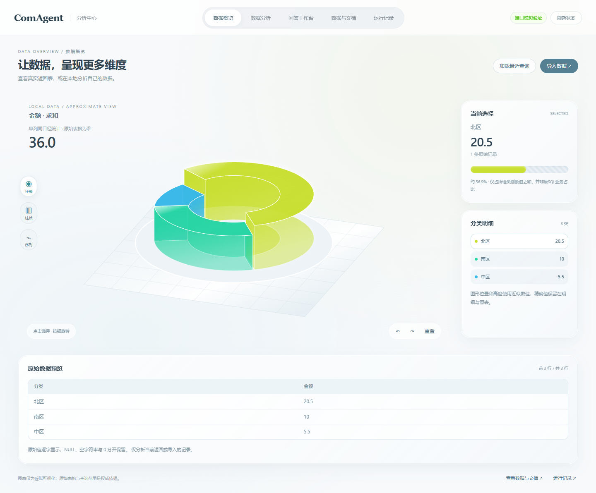
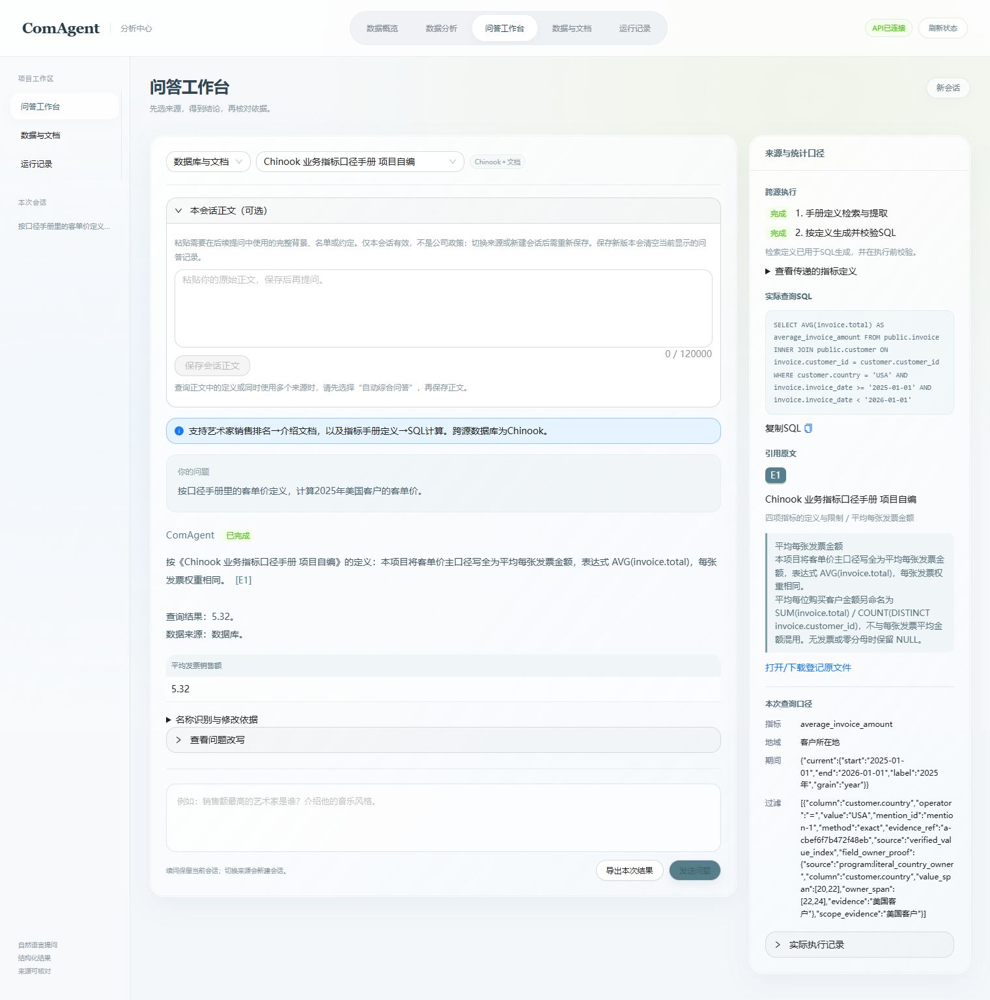

# 白色立体数据分析 UI 接入验收

验证日期：2026-10-17。项目入口：`http://127.0.0.1:8501/`。

结论：提供的独立安装包不能直接覆盖现有前端；现已按其白色立体风格完成适配，并通过本地浏览器和现有真实 API 联调。保留 ComAgent 文字名称，移除品牌图形与品牌 favicon。本次没有改变数据库、题库、业务口径或问答算法。

## 1. 接入方式与改动

原包的来源路由、长正文接收、精度展示、文档原页与代理范围与当前项目存在差异。采用现有 React、Ant Design 和已验证的契约层，复用其视觉与图形几何；没有运行压缩包中的 EXE 或另起远程代理。

| 部分 | 实现与文件 |
|---|---|
| 导航与问答 | `src/main.jsx`：默认数据概览；数据分析、问答工作台、数据与文档、运行记录五项文字导航。沿用当前会话、来源、澄清卡片与证据面板。保存新正文时同步清除历史选中项；请求进行中不覆盖问题草稿。 |
| 白色布局 | `src/workbench-white.css`：浅色渐变、半透明卡片、胶囊导航、工作台与窄屏布局。 |
| 数据分析 | `src/Analytics.jsx`、`src/analytics.css`：真实返回表与本地 CSV／TSV／JSON，三种立体 SVG 图表、选择、旋转、重置、原始表预览与导出。默认空态。 |
| 统计与几何 | `src/analysis.mjs`、`src/chart.mjs`：精确十进制合计，NULL／空串／0 区分；单指标选择；图形近似值与原值分开。使用兼容构建目标的数组复制与反转。 |
| 原有接口桥接 | `src/contract.mjs`、`run_ui.py`：纳入本机既有的 auto／hybrid、正文绑定、中文业务表头与精度支持；本机回环代理允许 `/api/context`，保留路径与重定向限制。 |
| 构建 | `scripts/build.mjs`、`dist/`：无品牌图标、空 favicon，预构建资源全部本地加载，无新增依赖和 CDN。 |
| 服务端配套 | 独立提交 `3e58490` 保存此前已验证的 API／Agent 运行源码，避免只上传 UI 导致远端缺少正文接口或新请求字段。它是现有运行版本的源码快照，不是本次改写业务逻辑。 |

每项链接与截图均使用本目录内相对位置，可在 GitHub 查看。压缩包来源 SHA-256：`42c4677ad38caccfca0c98d589401fe75168d5e304517affa5c6a94b07b2b48d`。

`.gitattributes` 仅为本目录选定证据增加原字节保留规则，避免 Git 换行转换破坏日志哈希。从 Git 暂存内容导出的独立源码已验证：API 可离线导入，OpenAPI 包含 `/api/chat` 和 `/api/context`，请求支持正文绑定，11份选定证据的哈希全部一致。该检查复用本机依赖，不等于全新机器安装验收。

## 2. 实际验证

| 验证 | 实际结果 | 证据 |
|---|---|---|
| 构建 | 成功生成 `dist/index.html`、`app.js`、`app.css` | 构建命令见下；[浏览器收据](evidence/fixture-browser-review.json)含实际构建文件哈希 |
| 前端分析、精度、契约与控制测试 | **154/154 通过**，包括两个实际浏览器 DOM 下拉列表测试 | [完整输出](evidence/node-tests-154.log) |
| Python 本机代理 | **9/9 通过** | [完整输出](evidence/proxy-tests-9.log) |
| 问答工作台模拟接口联调 | **25项通过**；SQL、精度、NULL、空集、脱敏导出、版本澄清、来源切换、两类跨源、异常恢复等 | [工作台记录](evidence/fixture-workspace.json) |
| 长正文模拟接口联调 | **9项通过**；完整正文、无自动发送、会话绑定、续问、重置、auto 数据库选择及原值导出 | [正文记录](evidence/fixture-context.json) |
| 新分析模块浏览器检查 | **7组通过**；真实模拟返回表、中文指标标题、本地文件不自动外发、空串／NULL／0／负数区分 | [分析记录](evidence/fixture-analytics.json) |
| 正值立体环形图局部探针 | **5组通过**；环图启用、有限 SVG 几何、旋转／重置、三种图形数据一致、概览保留本地来源 | [局部探针](evidence/positive-ring-probe.json) |
| 响应式 | **1440、1024、736、320 px** 无整页横向溢出，导航和主要控件可操作；截图另行查看 | [浏览器收据](evidence/fixture-browser-review.json)、[手机截图](evidence/local-analysis-mobile.png) |
| 真实问答界面与现有 API | **7/7 请求返回 SUCCEEDED**，7条链路检查通过，`page_errors=[]` | [真实联调摘要](evidence/actual-smoke-summary.json) |

测试分类有交叉，表中数量不相加为一个“准确率”。模拟接口测试没有调用模型或业务查询；真实请求明确单列。

真实请求使用现有 `deepseek-flash`，包括发票查询、L1地域口径切换、同会话改年份、完整正文回答、正文条件进入 SQL、单文档引用、手册定义驱动 SQL。按实际 trace 关联原始提供商记录核算：**11次物理调用，75,872输入 token、2,072输出 token**；其中缓存命中输入54,016、未命中21,856，无失败尝试、无 usage 缺失。本轮没有新增模型裁判、保留题或完整消融实验。该联调用于接入验证，不能当作全题库准确率或正式比赛成绩。

本地原始请求、响应、截图与提供商原件保留在 `system/eval/artifacts/ui-white-integration/` 及 trace 指向的 `.runtime/provider-captures/`；Git 仅附本目录的选定验证资料、摘要及截图，不上传完整提示词、会话正文、模型原始日志或敏感配置。运行中的 API 使用的捕获目录与 `.env` 文本不同，统计按实际 trace 引用及其七个 trace ID 收集全部尝试，未声称对该目录做过调用前快照。

开发期间的两类测试准备失败保留于本机：合集初次未设置 Playwright 目录时两个 DOM 测试未启动；首次分析脚本先选禁用字段时操作顺序失败。补齐环境及调整为先选汇总方式后，最终检查通过。独立复核发现的数组反转兼容、图表中文标签、单列带引号空记录三处问题均已修正并补测。

## 3. 可复现命令

在 `system` 下，按本机实际 Node／Playwright／Chrome 路径配置后执行：

```powershell
# 构建；Node 必须在 PATH，或改为本机 node.exe 绝对路径
node frontend-workbench/scripts/build.mjs

# 本地测试；其中两个 DOM 测试需要已安装的 Playwright 与浏览器
node --test frontend-workbench/tests/analysis.test.mjs frontend-workbench/tests/contract.test.mjs frontend-workbench/tests/client-precision-independent.test.mjs frontend-workbench/tests/real-request-control.test.cjs frontend-workbench/tests/browser-real-smoke-checks.test.cjs frontend-workbench/tests/browser-context-sql-focus.test.cjs frontend-workbench/tests/browser-output-contract-checks.test.cjs frontend-workbench/tests/browser-white-analytics-checks.test.cjs
.\.venv\Scripts\python.exe -B -m pytest frontend-workbench/tests/test_proxy.py -q --disable-warnings

# 受控模拟服务，另一个终端执行各浏览器脚本；每次使用新的空输出目录
.\.venv\Scripts\python.exe -B frontend-workbench/tests/serve_fixture.py --api-port 35370 --ui-port 35371
$env:COMAGENT_QA_UI_URL='http://127.0.0.1:35371'
$env:COMAGENT_QA_API_URL='http://127.0.0.1:35370'
node frontend-workbench/tests/browser-check.cjs
node frontend-workbench/tests/browser-context.cjs
node frontend-workbench/tests/browser-white-analytics.cjs
```

真实浏览器脚本默认不发请求；本次显式设置 `COMAGENT_REAL_UI_SMOKE=1`，UI地址8501，额外 INNER／DISPLAY 为0，新证据目录为 `actual-001`，随后执行 `node frontend-workbench/tests/browser-real-smoke.cjs`。它会实际调用后端模型，不能套用模拟服务地址或把未运行写成成功。

## 4. 打开方式与边界

本机双击 `system/启动项目.cmd`，打开 **http://127.0.0.1:8501/**。原有后端服务和数据库继续复用，无需重新导入。若旧标签页缓存了页面，按 `Ctrl+F5` 刷新。API 文档仍为 `http://127.0.0.1:8000/docs`。

日常启动不需要 Node；修改前端源码后才需要构建。新机器仍需配置自己的 `.env`、只读数据库和原文／模型／索引资源；本次没有将本机资源自动迁移验证写成已完成。

本地分析支持 CSV、TSV、JSON／文本，不读取二进制 `.xlsx`；可从 Excel 复制表格。上限2MB、20,000行、100列。图形使用近似几何数值，权威依据仍是原始值和查询范围；比例与均值不重归一为环形占比，单值与负值不强制显示组成环。图示最多8类，完整分类与原始行可导出。

本地文件不会自动外发；“整理为草稿”只填写有限、明确标注的摘要。用户随后点击发送时，该摘要会进入后端并可能进入模型，不等于上传整个文件。运行记录为当前会话内存状态，不宣称为跨浏览器持久档案。

本轮实际浏览器为 Windows 上 Chrome155；旧浏览器范围仅做构建目标及缺少 `toReversed` 的本地兼容检查，没有宣称在 Safari／Firefox 真机完成验证。未进行 D5 保留集评测或全系统并发压测。

## 5. 截图

本地正值立体图示：下图明确为本地模拟数据探针，不是业务库实测统计。



真实手册定义到 SQL 联调：


